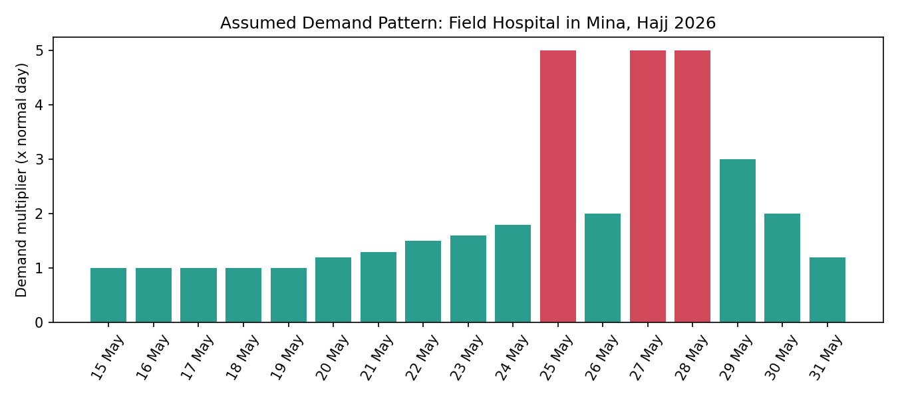
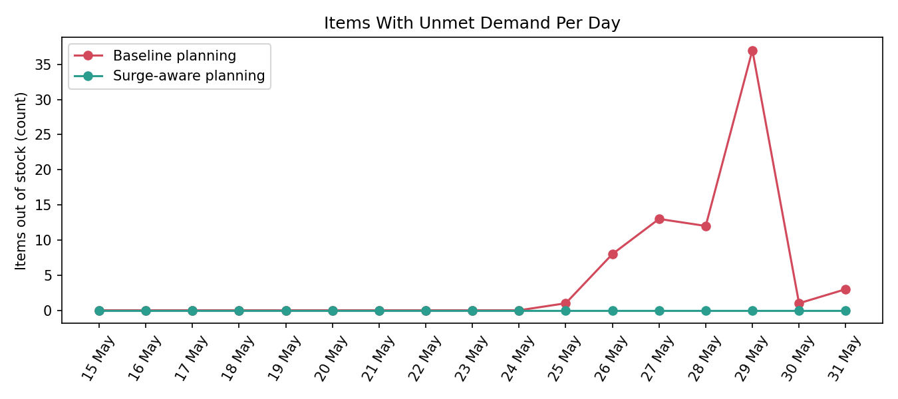
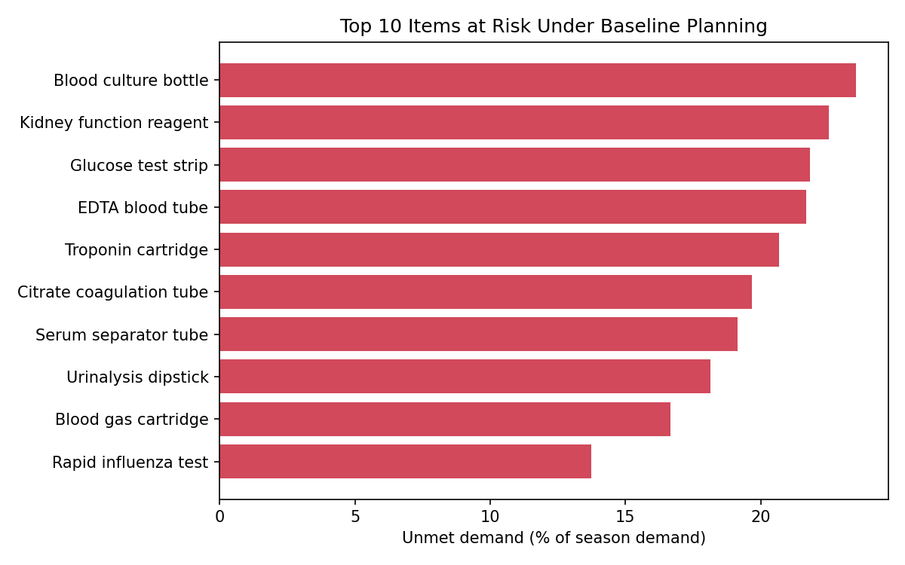
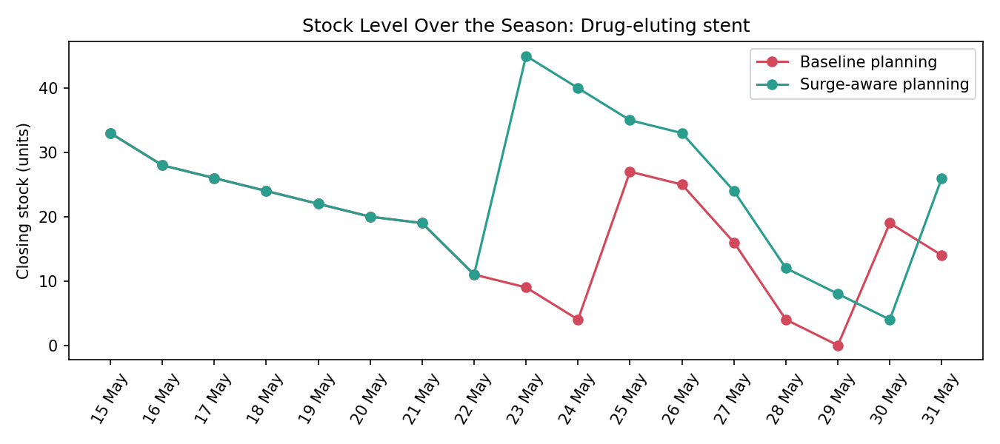
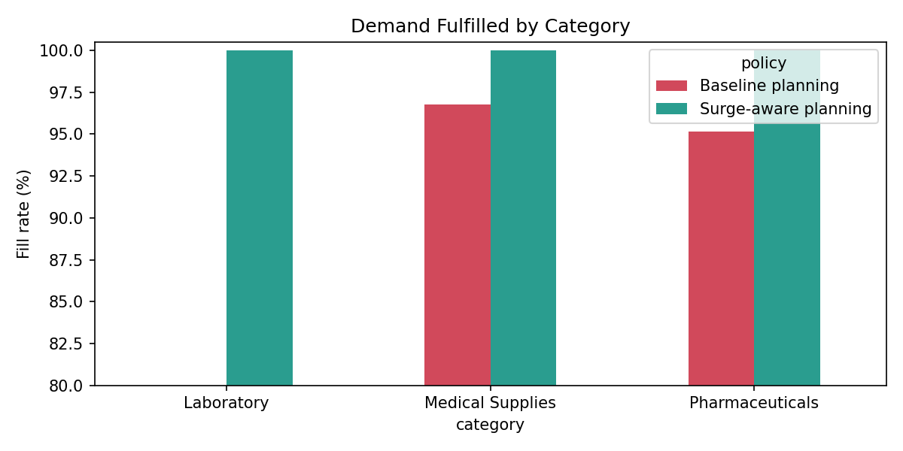

# Hajj Season Medical Supply Readiness

> **Note on data:** This project is a **simulation** for a **fictional** field hospital in Mina during the Hajj 1447 / 2026 season. It is inspired by the author's hands-on experience with medical supplies during Hajj. **Every number is an assumption** created to demonstrate the method. No real hospital, patient, or supply data is used.

## Objective
Show how a field hospital can plan medical supply levels for a short, extreme demand surge, and where a plan built on a normal day breaks down.

## The Scenario
- 9 departments: Emergency, Trauma ICU, Burn Unit, ICU, Inpatient Wards, Pharmacy, Laboratory, Radiology, Cath Lab
- 80 generic items (50 medical supplies, 20 pharmaceuticals, 10 laboratory), each with a criticality class (A, B, C), supply channel, and lead time
- Operating period: 15 to 31 May 2026 (17 days)
- Peak days: 8, 10, and 11 Dhul Hijjah (25, 27, and 28 May), assumed at **5x** a normal pre-season day



## Method
1. **Generate demand:** daily consumption per department and item (Poisson), scaled by the demand calendar. Each department responds to the surge with a different sensitivity (for example, Emergency fully, Cath Lab only partly).
2. **Simulate stock** for the whole season under two planning policies, both with the same opening stock (12 normal days) and the same resupply lead times (2 to 4 days):
   - **Baseline planning:** reorder level and order-up-to level sized on a normal day.
   - **Surge-aware planning:** the same rules, but sized on the expected demand calendar.
3. **Repeat 200 times** (Monte Carlo) to check that the result is stable.
4. **Recommend** reorder levels for the peak window.

## Key Findings (simulation results)

| Measure | Baseline planning | Surge-aware planning |
|---|---|---|
| Demand fulfilled (mean of 200 runs) | 94.1% | 99.98% |
| Stockout item-days (mean of 200 runs) | 73 | 2 |
| Critical (class A) stockout item-days | 22 | 1 |

1. **Hospital-wide demand peaks at about 4.4x a normal day,** even though the peak days are 5x, because departments respond differently.
2. **Plans built on a normal day fail at the peak.** In the sample run, 51 of 80 items ran out at least once, including 14 of 22 critical items. The first stockout appeared on 25 May.
3. **The worst day is after the peak, not during it.** Stockouts reached 37 items on 29 May, because resupply takes 2 to 4 days and replenishment arrives after the surge has already drained stock.
4. **Cover is thin when the peak starts.** At the end of 24 May, 60 of 80 items had less than 2 days of cover at peak demand. The lowest were drug-eluting stents (0.8 days), insulin (1.0 day), and chest drain kits (1.2 days).
5. **Reorder levels need to be several times higher for the peak window.** For example: Ringer's lactate 1,492 vs 450 units, insulin 131 vs 40 vials, drug-eluting stents 34 vs 18 pieces (see `reorder_recommendations.csv`).






## Limitations
- **Results follow from the assumptions.** The surge size, department sensitivities, opening stock, and lead times are illustrative. Real figures would change the numbers, not the method.
- **Surge-aware planning assumes the demand calendar is known in advance,** so it is a best case. A real forecast would be less accurate.
- Supplier stock is assumed unlimited, and items are tracked at hospital level (one central store per item).
- Arafah day (26 May) is assumed at 2.0x and the ramp-up and wind-down shapes are illustrative. Edit `demand_multipliers.xlsx` or `generate_data.py` to test other patterns.

## Repository Structure
```
hajj-supply-readiness/
├── generate_data.py              # Synthetic data + stock simulation (seeded, reproducible)
├── analyze_supply.py             # KPIs, reorder recommendations, charts
├── demand_multipliers.xlsx       # Editable demand calendar (assumptions)
├── items.csv                     # 80 items with criticality, channel, lead time
├── departments.csv               # Surge sensitivity per department
├── daily_multipliers.csv         # Demand calendar
├── daily_consumption.csv         # Simulated consumption by day, department, item
├── stock_simulation.csv          # Daily stock under both policies
├── monte_carlo_summary.csv       # 200-run summary
├── kpi_summary.csv               # KPIs for the sample run
├── reorder_recommendations.csv   # Recommended reorder levels for the peak
├── chart_*.png
└── README.md
```

## How to Run
```
pip install pandas numpy matplotlib
python generate_data.py
python analyze_supply.py
```

## Project Status
Python simulation and analysis complete. Next: interactive Power BI dashboard (executive summary, item risk, department view, reorder recommendations).

## Author
**Yosra El Nagar**: Nursing Supervisor transitioning into Healthcare Data Analytics
[LinkedIn](https://www.linkedin.com/in/yosra-nagar-9a6862118/)

---

## 🇸🇦 ملخص بالعربي

محاكاة لمستشفى ميداني **وهمي** في منى خلال موسم حج 1447 / 2026، مستوحاة من خبرة عملية في إمدادات الحج. **كل الأرقام افتراضية** لتوضيح المنهجية، ولا توجد أي بيانات حقيقية.

- التخطيط على أساس يوم عادي يفشل وقت الذروة: نفدت 51 من 80 صنف مرة واحدة على الأقل في عيّنة المحاكاة، منها 14 من 22 صنف حرج.
- أسوأ يوم كان **بعد الذروة** (29 مايو) بسبب تأخر التوريد من 2 إلى 4 أيام.
- مستوى إعادة الطلب المناسب لفترة الذروة أعلى بعدة أضعاف من المستوى المعتاد.
- **القيود:** النتائج مبنية على افتراضات، والتخطيط الواعي بالذروة يفترض معرفة مسبقة بمنحنى الطلب.
